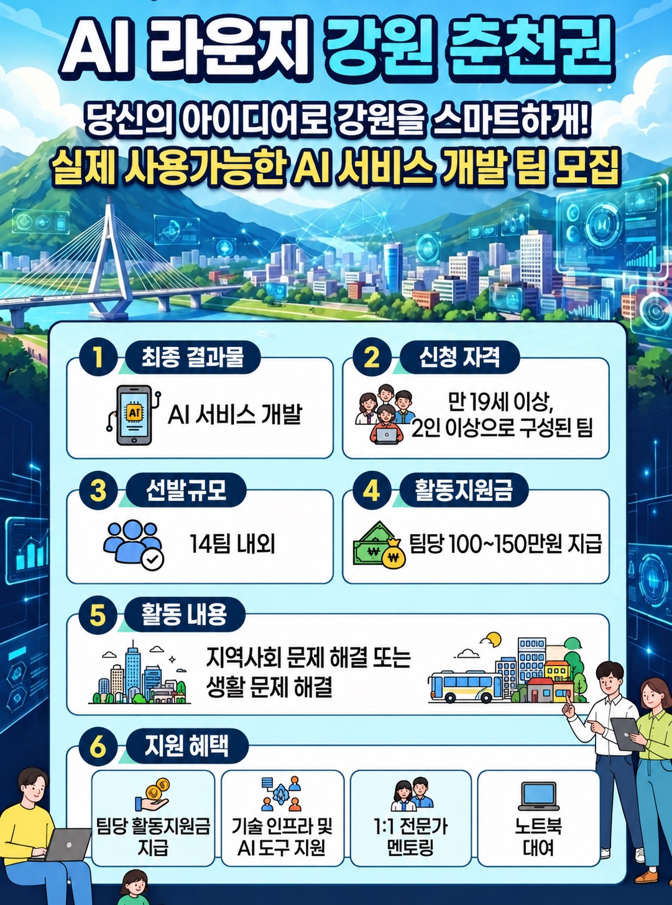

# 🚴 Cycle AI Coach

> 사용자의 신체 정보와 훈련 목표를 입력하면 AI가 **맞춤형 8주 사이클 훈련 프로그램**을 만들어 주는 서비스

**팀 코칭랩스** · AI 라운지 강원 춘천권 「My AI 랩 프로젝트」 참가작



---

## 해결하려는 문제

- 파워미터 보급으로 동호인도 FTP, 평균 파워 같은 전문 지표를 볼 수 있게 됐지만, 이 수치를 **실제 훈련 계획으로 연결하기는 어렵습니다.**
- 전문 코칭을 꾸준히 받기 어려운 동호인은 비슷한 강도의 운동을 반복하거나, 회복 수준에 맞지 않는 훈련을 하기 쉽습니다.
- AI 도구가 있어도 "무엇을 입력하고 결과를 어떻게 해석할지"가 또 하나의 진입장벽이 됩니다.

## 주요 기능

| 기능 | 설명 | 상태 |
|---|---|---|
| 기본정보 입력 | 나이, 체중, FTP, 훈련 경력, 주당 훈련 시간·횟수, 훈련 목적 | ✅ 시제품 |
| AI 8주 훈련 프로그램 생성 | 주차별 목표, 세션별 목적·강도·시간·인터벌 구성 | ✅ 시제품 |
| 파워 기반 훈련 | FTP · IF · TSS 기준 강도와 훈련량 설계 | ✅ 시제품 |
| 심박수 기반 훈련 | 파워미터 없는 사용자용, 카보넨 공식 목표심박수 + RPE | ✅ 시제품 |
| 훈련 도식 시각화 | 강도·휴식 구간을 그림으로 표시 | 🔧 개선 중 |
| 춘천 안전 코스·관광명소 안내 | 지도 기반 자전거 코스 추천 | 💡 기획 중 |

## 팀 구성과 역할

| 역할 | 담당 |
|---|---|
| 팀장 | 사이클 훈련 전문성, 훈련 프로그램 설계·검증 (사이클 지도 경력 약 6년) |
| 팀원 | AI 기반 서비스 구현, 입력·결과 화면(UI) 설계 |

## 진행 일정

| 기간 | 내용 |
|---|---|
| 2026.11 | 춘천 동호인 훈련 실태 조사, 훈련 원리(FTP·IF·TSS) 정리, AI 훈련 설계 기준 수립 |
| 2026.12 | 시제품 개발 및 기능 개선, 훈련 도식·주간 훈련량 표시 |
| 2027.01 | 춘천 지역 동호인 실사용 테스트, 피드백 반영 및 최종 보완 |

## 폴더 구조

```
├── README.md            프로젝트 소개 (지금 보고 있는 문서)
├── docs/
│   ├── devlog.md        개발 일지 (업데이트할 때마다 기록)
│   ├── project-plan.md  개발 계획 요약
│   ├── mentoring/       멘토링 기록
│   └── images/          포스터, 스크린샷
└── (앱 설치 파일은 Releases 탭에서 내려받을 수 있어요)
```

## 개발 기록

진행 과정은 [개발 일지](docs/devlog.md)에 날짜별로 정리하고 있습니다.
